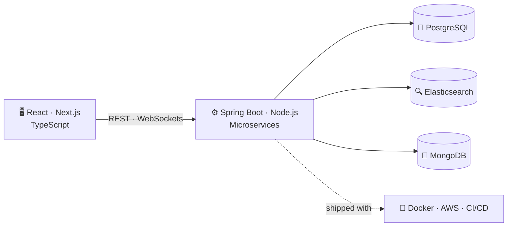

<p align="center">
  
</p>

<p align="center">
  
</p>

<p align="center">
  <a href="https://www.linkedin.com/in/vipullakhara/"></a>
  <a href="mailto:vipullakhara18@gmail.com"></a>
  
</p>

---

## `cat about.ts`

```ts
const vipul = {
  role: "Software Engineer",
  company: "Thoughtworks",          // joined Sept 2026
  location: "Bengaluru, India",
  previously: "Lanatus Systems LLP", // Dec 2022 → 2026
  education: "M.Sc. IT, Sardar Patel University",
  focus: ["full-stack features", "microservices", "search", "real-time systems"],
  loves: ["clean code", "well-tested services", "fast, reliable products"],
  openTo: ["interesting projects", "great conversations"],
};
```

---

## 🧭 How I build



---

## 🧰 Toolbox

| Layer | Tools |
|---|---|
| **Languages** |      |
| **Backend** |      |
| **Frontend** |     |
| **Data** |    |
| **Cloud & Ops** |    |
| **Quality** |    |

---

## 📜 `git log` of my work

```text
feat(react)    reusable components + cleaner state     → ~20% fewer UI defects
feat(spring)   PostgreSQL ⇄ Elasticsearch sync service → +30% sync accuracy
perf(search)   nested sorting + inner hits tuned       → ~40% less compute
test(junit)    unit + integration suites               → 100% coverage on Spring Boot services
fix(prod)      root-cause analysis from SLF4J logs and devtools
```

---

## ♟️ Featured: Real-Time Multiplayer Chess

<a href="https://ch3ss.netlify.app"></a>

A full-stack chess game where two players move in real time. The frontend is **Next.js + TypeScript**, and a **Java Spring Boot** backend manages live WebSocket sessions and keeps both players in sync.

- ♞ Full rule enforcement: castling, en passant and checkmate detection
- ⚡ Real-time play over WebSockets and Socket.IO
- 📦 Code: [chess-frontend](https://github.com/vlakhara/chess-frontend) · [chess-backend](https://github.com/vlakhara/chess-backend)

**Also on my shelf:** [messenger-clone](https://github.com/vlakhara/messenger-clone) · [webrtc-demo](https://github.com/vlakhara/webrtc-demo) · [Portfolio](https://github.com/vlakhara/Portfolio)

---

## 🔥 Activity

<p align="center">
  
</p>

---

<p align="center">
  <i>Got an interesting project or idea? Let's talk.</i><br><br>
  <a href="https://www.linkedin.com/in/vipullakhara/"></a>
</p>

<p align="center">
  
</p>
